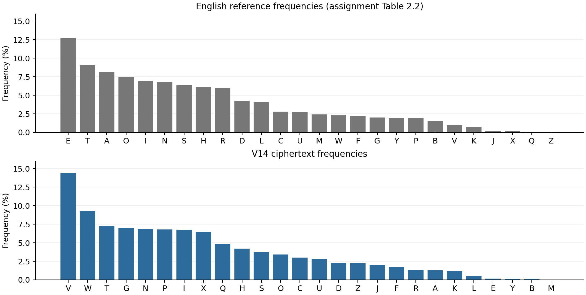
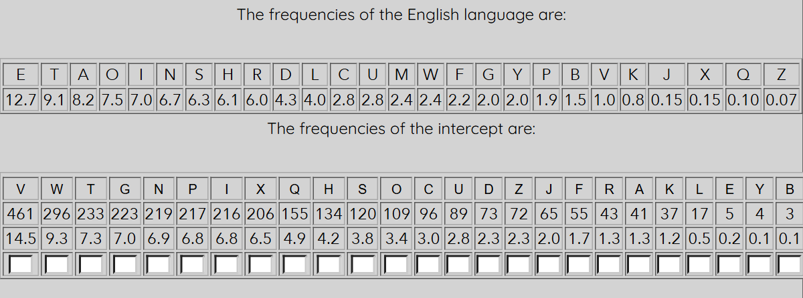
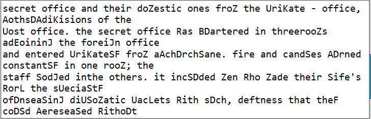
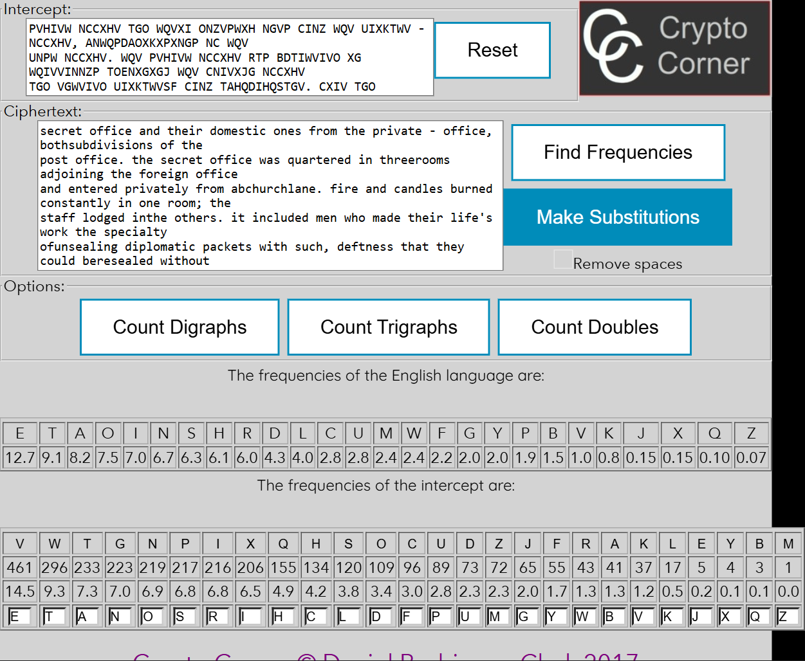
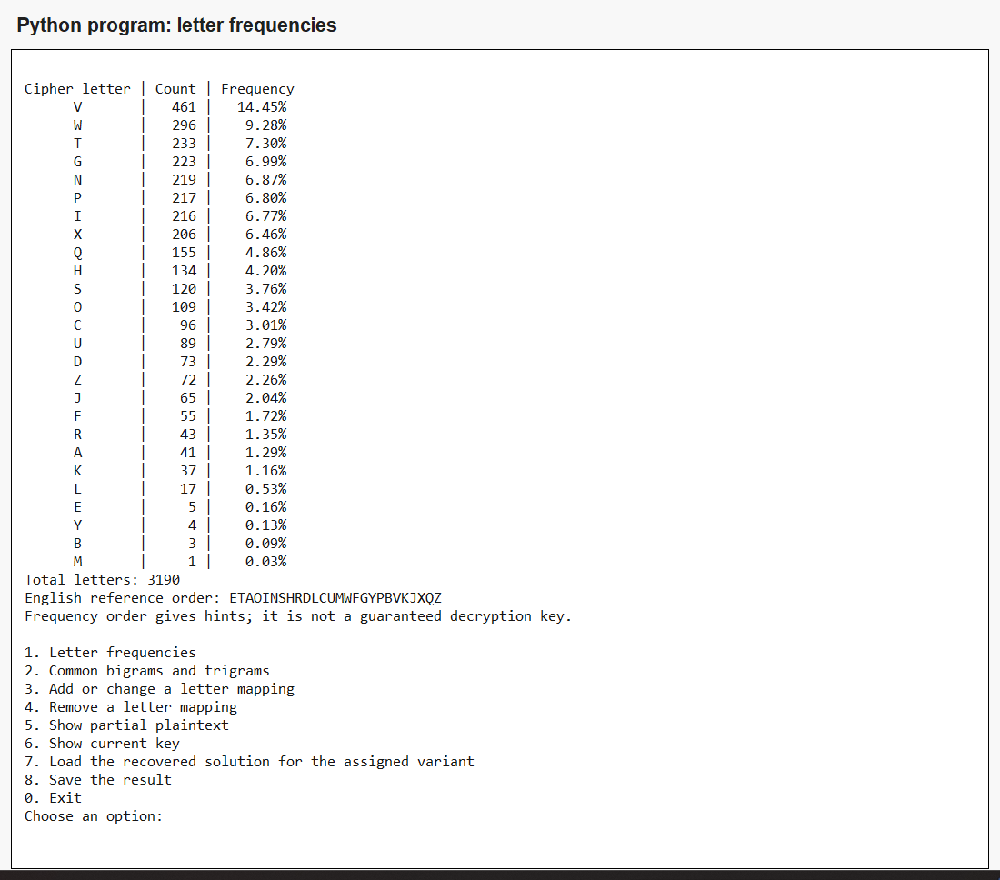
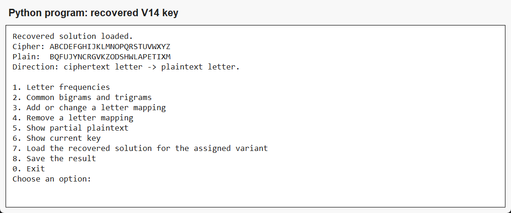
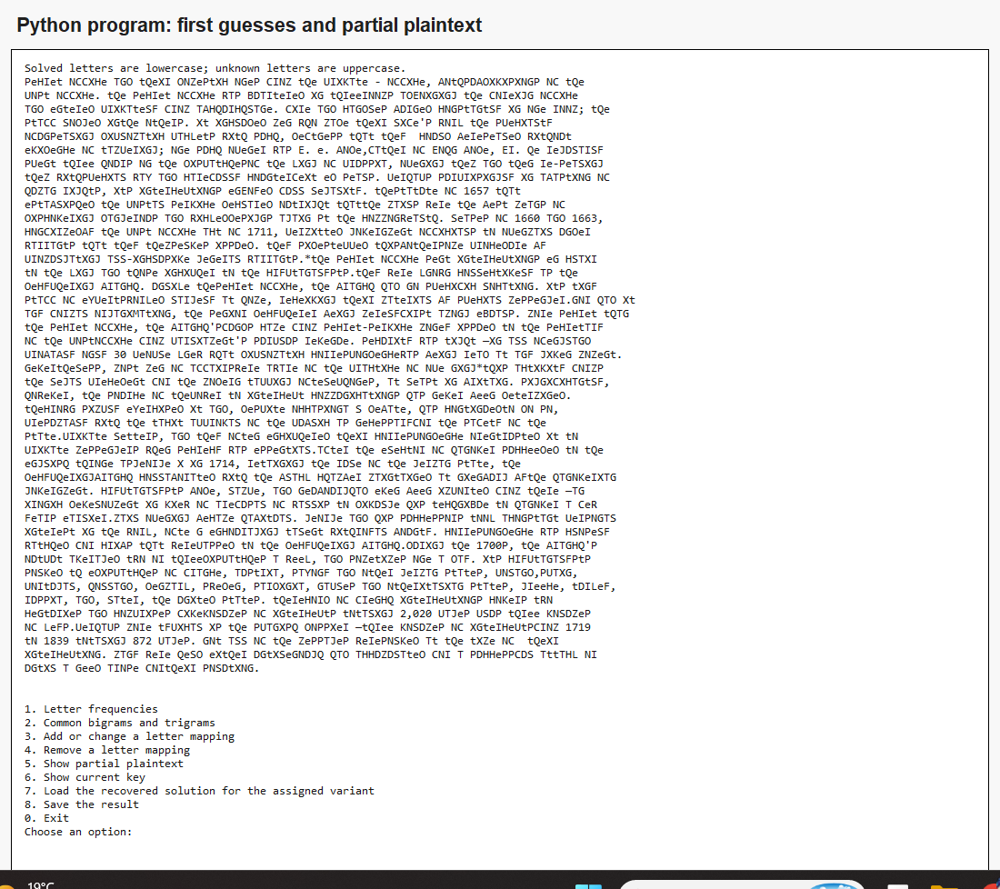
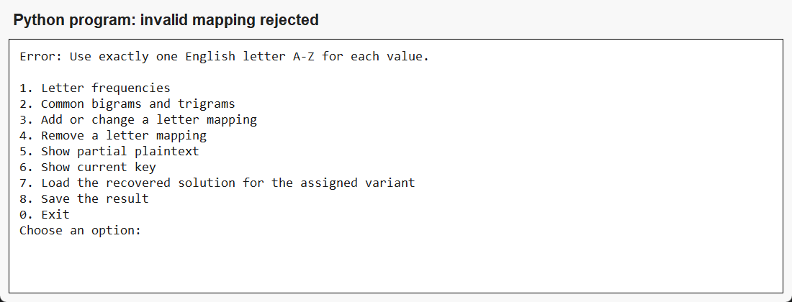

# LABORATORY WORK No. 2

Cryptanalysis of Monoalphabetic Ciphers

Frequency-analysis attack — Variant V14

Author: Luchiciov Alexei  
Group: FAF-241  
Teacher: Maia Zaica  
Language: Python 3

6 October 2026

---

## 1. Aim, theory and implementation

The task is to recover the English message in variant V14 using frequency analysis. Only the letters were encrypted, so spaces, punctuation, numbers and line breaks must be kept. I follow the step-by-step method from Section 2.3 of the assignment and use the required Crypto Corner activity.

A monoalphabetic cipher always replaces a given plaintext letter with the same ciphertext letter. It therefore preserves letter frequencies and repeated word patterns. Frequencies give initial guesses, while common words and context help confirm or correct them.

```text
frequency(letter) = count(letter) / total_English_letters × 100%
```

The denominator includes only A–Z letters. English frequencies vary between passages, so replacing letters only by their frequency rank is not sufficient.

## 1.1. Simple Python support program

```python
def letter_counts(text):
    """Count English letters only, ignoring letter case."""
    return Counter(letter.upper() for letter in text
                   if letter in string.ascii_letters)

def frequency_table(text):
    counts = letter_counts(text)
    total = sum(counts.values())
    return [(letter, counts[letter],
             100 * counts[letter] / total if total else 0.0)
            for letter in sorted(ALPHABET,
                                 key=lambda letter: (-counts[letter], letter))]
```

These functions count uppercase and lowercase English letters together and return a descending frequency table. The reference frequencies in the program are taken from Table 2.2 of the supplied assignment.

```python
def replace_letters(text, mapping, partial=False):
    """Preserve nonletters. A partial preview uses lowercase for solved letters."""
    result = []
    for letter in text:
        if letter in string.ascii_letters and letter.upper() in mapping:
            value = mapping[letter.upper()]
            result.append(value.lower() if partial or letter.islower() else value)
        else:
            result.append(letter.upper() if partial
                          and letter in string.ascii_letters else letter)
    return "".join(result)
```

The program replaces letters using a dictionary in ciphertext-to-plaintext direction. In a partial preview, solved letters are lowercase and unknown letters remain uppercase, as in the assignment's example. The final output preserves the original case and all nonletters.

The menu also lists common bigrams and trigrams, accepts or removes letter guesses, shows the key and saves the result. Duplicate plaintext assignments are rejected. The --demo option replays this documented V14 attack; it is not a general automatic solver.

---

## 2. Frequency analysis of V14

I counted 3,190 English letters. All 26 ciphertext letters occur. The most frequent are V (14.45%), W (9.28%) and T (7.30%). The letter M occurs only once.

| Cipher | Count | Frequency | Cipher | Count | Frequency |
| --- | --- | --- | --- | --- | --- |
| V | 461 | 14.45% | U | 89 | 2.79% |
| W | 296 | 9.28% | D | 73 | 2.29% |
| T | 233 | 7.30% | Z | 72 | 2.26% |
| G | 223 | 6.99% | J | 65 | 2.04% |
| N | 219 | 6.87% | F | 55 | 1.72% |
| P | 217 | 6.80% | R | 43 | 1.35% |
| I | 216 | 6.77% | A | 41 | 1.29% |
| X | 206 | 6.46% | K | 37 | 1.16% |
| Q | 155 | 4.86% | L | 17 | 0.53% |
| H | 134 | 4.20% | E | 5 | 0.16% |
| S | 120 | 3.76% | Y | 4 | 0.13% |
| O | 109 | 3.42% | B | 3 | 0.09% |
| C | 96 | 3.01% | M | 1 | 0.03% |



Figure 1. Reference and observed frequencies, each ordered by frequency.

The common ciphertext trigrams include WQV (75 occurrences), XGJ (24) and TGO (21). These counts use overlapping groups inside words and do not cross spaces or punctuation. They provide clues for THE, ING and AND.

---

## 3. Step-by-step recovery

For each stage I record the new substitutions, the reason and a short excerpt of the resulting message. Lowercase letters are solved. Complete intermediate messages are saved in analysis_steps/step_01.txt through step_08.txt.

## 3.1. Start with the most frequent letters

V and W are the two most frequent ciphertext letters. E and T are the most frequent letters in the English reference table. I first try V → E and W → T, and treat these choices as hypotheses.

```text
New substitutions: V → E, W → T
```

```text
PeHIet NCCXHe TGO tQeXI ONZePtXH NGeP CINZ tQe UIXKTte - NCCXHe, ANtQPDAOXKXPXNGP NC
tQe  UNPt NCCXHe. tQe PeHIet NCCXHe RTP BDTIteIeO XG tQIeeINNZP TOENXGXGJ tQe CNIeXJG
NCCXHe  TGO eGteIeO UIXKTteSF CINZ TAHQDIHQSTGe. CXIe TGO HTGOSeP ADIGeO HNGPtTGtSF XG
NGe INNZ; tQe  PtTCC SNOJeO XGtQe NtQeIP. Xt XGHSDOeO ZeG RQN ZTOe tQeXI SXCe'P RNIL
tQe PUeHXTStF  NCDGPeTSXGJ OXUSNZTtXH UTHLetP RXtQ PDHQ,
[Excerpt; the complete stage is provided in analysis_steps/.]
```

## 3.2. Recognize THE and the single-letter word A

The repeated group WQV now reads tQe, which strongly suggests THE, so Q → H. The isolated letter T is used as a word and is also very frequent. I try T → A; the surrounding phrases support this choice.

```text
New substitutions: Q → H, T → A
```

```text
PeHIet NCCXHe aGO theXI ONZePtXH NGeP CINZ the UIXKate - NCCXHe, ANthPDAOXKXPXNGP NC
the  UNPt NCCXHe. the PeHIet NCCXHe RaP BDaIteIeO XG thIeeINNZP aOENXGXGJ the CNIeXJG
NCCXHe  aGO eGteIeO UIXKateSF CINZ aAHhDIHhSaGe. CXIe aGO HaGOSeP ADIGeO HNGPtaGtSF XG
NGe INNZ; the  PtaCC SNOJeO XGthe NtheIP. Xt XGHSDOeO ZeG RhN ZaOe theXI SXCe'P RNIL
the PUeHXaStF  NCDGPeaSXGJ OXUSNZatXH UaHLetP RXth PDHh,
[Excerpt; the complete stage is provided in analysis_steps/.]
```

## 3.3. Recognize AND, IT and IN

The repeated word TGO now starts with a and fits AND, giving G → N and O → D. XW becomes Xt and fits IT, giving X → I. The frequent group XG then becomes IN, which confirms the guess.

```text
New substitutions: G → N, O → D, X → I
```

```text
PeHIet NCCiHe and theiI dNZePtiH NneP CINZ the UIiKate - NCCiHe, ANthPDAdiKiPiNnP NC
the  UNPt NCCiHe. the PeHIet NCCiHe RaP BDaIteIed in thIeeINNZP adENininJ the CNIeiJn
NCCiHe  and enteIed UIiKateSF CINZ aAHhDIHhSane. CiIe and HandSeP ADIned HNnPtantSF in
Nne INNZ; the  PtaCC SNdJed inthe NtheIP. it inHSDded Zen RhN Zade theiI SiCe'P RNIL
the PUeHiaStF  NCDnPeaSinJ diUSNZatiH UaHLetP Rith PDHh,
[Excerpt; the complete stage is provided in analysis_steps/.]
```

---

## 3. Step-by-step recovery — continued

## 3.4. Recognize SECRET OFFICE and OF

The opening words PVHIVW NCCXHV have the pattern ?e??et ???i?e. In this context they fit SECRET OFFICE. These words give P → S, H → C, I → R, N → O and C → F. The frequent word NC becomes OF and gives another check.

```text
New substitutions: P → S, H → C, I → R, N → O, C → F
```

```text
secret office and their doZestic ones froZ the UriKate - office, AothsDAdiKisions of
the  Uost office. the secret office Ras BDartered in threerooZs adEoininJ the foreiJn
office  and entered UriKateSF froZ aAchDrchSane. fire and candSes ADrned constantSF in
one rooZ; the  staff SodJed inthe others. it incSDded Zen Rho Zade their Sife's RorL
the sUeciaStF  ofDnseaSinJ diUSoZatic UacLets Rith sDch,
[Excerpt; the complete stage is provided in analysis_steps/.]
```

## 3.5. Recover FULL, MAILS and POST

CDSS has the pattern fDSS, including a repeated final letter. In the phrase about enjoying legality, FULL is a good fit, giving D → U and S → L. ZTXSP then becomes Zails and fits MAILS, giving Z → M. UNPW becomes Uost and fits POST, giving U → P. These replacements also make PRIVATE and POST OFFICE readable.

```text
New substitutions: D → U, S → L, Z → M, U → P
```

```text
secret office and their domestic ones from the priKate - office, AothsuAdiKisions of
the  post office. the secret office Ras Buartered in threerooms adEoininJ the foreiJn
office  and entered priKatelF from aAchurchlane. fire and candles Aurned constantlF in
one room; the  staff lodJed inthe others. it included men Rho made their life's RorL
the specialtF  ofunsealinJ diplomatic pacLets Rith such,
[Excerpt; the complete stage is provided in analysis_steps/.]
```

## 3.6. Recover GOVERNMENT, WITH, THEY and KING

JNKVIGZVGW now reads JoKernment and fits GOVERNMENT, giving J → G and K → V. RXWQ becomes Rith and fits WITH, giving R → W. WQVF becomes theF and fits THEY, giving F → Y. LXGJ becomes Ling and fits KING, giving L → K.

```text
New substitutions: J → G, K → V, R → W, F → Y, L → K
```

```text
secret office and their domestic ones from the private - office, AothsuAdivisions of
the  post office. the secret office was Buartered in threerooms adEoining the foreign
office  and entered privately from aAchurchlane. fire and candles Aurned constantly in
one room; the  staff lodged inthe others. it included men who made their life's work
the specialty  ofunsealing diplomatic packets with such,
[Excerpt; the complete stage is provided in analysis_steps/.]
```

---

## 3. Step-by-step recovery — final stages

## 3.7. Resolve the less frequent letters

AITGHQ reads Aranch and fits BRANCH, giving A → B. ENQG reads Eohn and fits JOHN, giving E → J. BDTIWVIVO reads Buartered and fits QUARTERED, giving B → Q. VYUVIWP reads eYperts and fits EXPERTS, giving Y → X. Other appearances, such as EXERCISED, support the last guess.

```text
New substitutions: A → B, E → J, B → Q, Y → X
```

```text
secret office and their domestic ones from the private - office, bothsubdivisions of
the  post office. the secret office was quartered in threerooms adjoining the foreign
office  and entered privately from abchurchlane. fire and candles burned constantly in
one room; the  staff lodged inthe others. it included men who made their life's work
the specialty  ofunsealing diplomatic packets with such,
[Excerpt; the complete stage is provided in analysis_steps/.]
```

## 3.8. Resolve the rarest letter and verify the complete key

Only M remains unresolved. NIJTGXMTWXNG reads organiMation and fits ORGANIZATION, so M → Z. M occurs once in this variant. All 26 ciphertext letters are now mapped to 26 different plaintext letters. I read the result and re-encrypt it to check that it reproduces the ciphertext.

```text
New substitutions: M → Z
```

```text
secret office and their domestic ones from the private - office, bothsubdivisions of
the  post office. the secret office was quartered in threerooms adjoining the foreign
office  and entered privately from abchurchlane. fire and candles burned constantly in
one room; the  staff lodged inthe others. it included men who made their life's work
the specialty  ofunsealing diplomatic packets with such,
[Excerpt; the complete stage is provided in analysis_steps/.]
```

## 3.9. Recovered substitution alphabet

| Cipher | A | B | C | D | E | F | G | H | I | J | K | L | M |
| --- | --- | --- | --- | --- | --- | --- | --- | --- | --- | --- | --- | --- | --- |
| Plain | B | Q | F | U | J | Y | N | C | R | G | V | K | Z |
| Cipher | N | O | P | Q | R | S | T | U | V | W | X | Y | Z |
| Plain | O | D | S | H | W | L | A | P | E | T | I | X | M |

```text
Cipher: ABCDEFGHIJKLMNOPQRSTUVWXYZ
Plain:  BQFUJYNCRGVKZODSHWLAPETIXM
```

Every cipher letter has a different plaintext value. The recovered plaintext starts with 'Secret Office and their domestic ones from the Private - Office'. Reading the passage confirms a consistent English historical text.

---

## 4. Required Crypto Corner activity

I pasted V14 into the required activity, clicked Find Frequencies and kept Remove spaces unchecked. I entered the same substitutions after each stage and clicked Make Substitutions.

[https://crypto.interactive-maths.com/frequency-analysis-breaking-the-code.html](https://crypto.interactive-maths.com/frequency-analysis-breaking-the-code.html)



Figure 2. The service's reference table and V14 frequencies.



Figure 3. Partial plaintext in the service after Step 4.

---

## 4.1. Complete result in Crypto Corner



Figure 4. Complete substitution in the service; all 26 mappings are entered.

The service returned the same counts for all 26 letters and the same preview after each of the eight stages. Its completed display is lowercase; the Python final result keeps the source letter case. The saved verification is in output/crypto_corner_verification.json.

---

## 5. Python program results

The interactive program starts with an empty key. It can be used to explore the frequencies and test each substitution. Option 7 loads the recovered key for this assigned variant.



Figure 5. The Python frequency table.



Figure 6. The complete key is loaded and shown in the correct direction.

---

## 5.1. Partial plaintext and input validation



Figure 7. A partial preview after the first V → E and W → T guesses.



Figure 8. A digit cannot be used as a letter mapping.

The program also prevents two ciphertext letters from being assigned to the same plaintext letter. A wrong guess can be changed or removed, so the analysis can continue without restarting.

---

## 6. Complete recovered plaintext

The following is the complete decoded V14 message. The source PDF contains joined words and occasional spaces inside words. These are preserved, together with numbers, punctuation and line breaks, in output/plaintext.txt. Display wrapping in the report does not change the letters.

```text
Secret Office and their domestic ones from the Private - Office, bothsubdivisions of the 
Post Office. The Secret Office was quartered in threerooms adjoining the Foreign Office 
and entered privately from AbchurchLane. Fire and candles burned constantly in one room; the 
staff lodged inthe others. It included men who made their life's work the specialty 
ofunsealing diplomatic packets with such, deftness that they  could beresealed without 
evidence of tampering; one such opener was J. E. Bode,father of John Bode, Jr. He regularly 
spent three hours on the dispatchesof the King of Prussia, opening them and then re-sealing 
them withspecial wax and carefully counterfeit ed seals. Perhaps surprisingly in abastion of 
human rights, its interceptions enjoyed full legality. Thestatute of 1657 that 
established the postal service declared outright thatthe mails were the best means of 
discovering dangerous and wickeddesigns again st the commonwealth. Leases of 1660 and 1663, 
confirmedby the Post Office Act of 1711, permitted government officials to openmail under 
warrants that they themselves issued. They sidestepped thisbothersome procedure by 
promulgating all-inclusive general warrants.*The Secret Office sent interceptions en clair 
to the king and those incipher to the cryptanalysts.They were known collectively as the 
Decyphering Branch. Unlike theSecret Office, the branch had no specific location. Its tiny 
staff of expertsworked largely at home, receiving their material by special messenger.Nor had it 
any formal organization, the senior Decypherer being merelyfirst among equals. More secret than 
the Secret Office, the branch'sfunds came from secret-service money issued to the Secretary 
of the PostOffice from Parliament's surplus revenue. Security was tight —in all ofEngland 
probably only 30 people knew what diplomatic correspondencewas being read at any given moment. 
Nevertheless, most men of affairswere aware of the practice of ope ning*This activity forms 
the legal precedent for the modern tapping oftelephones, at least in Britain. Significantly, 
however, the source of thepower to intercept communications has never been determined. 
TheCrown simply exercised it and, despite occasiona l debate, has continuedto do so, 
presumably with the tacit approval of the public as necessaryfor the safety of the 
state.private letters, and they often enciphered their correspondence orentrusted it to 
private messengers when secrecy was essential.After the Elector of Hanover succeeded to the 
English throne asGeorge I in 1714, retaining the rule of the German state, the 
DecypheringBranch collaborated with the black chamber maintained at Nienburg bythe Hanoverian 
government. Cryptanalysts Bode, Lampe, and Neubourghad even been imported from there —an 
ironic development in view of arefusal of Wallis to divulge his technique to Hanover a few 
years earlier.Mail opening became habitual. George and his successors took aconstant personal 
interest in the work, ofte n encouraging talent withroyal bounty. Correspondence was closely 
watched for cribs that werepassed to the Decyphering Branch.During the 1700s, the branch's 
output averaged two or threedispatches a week, and sometimes one a day. Its cryptanalysts 
solved th edispatches of France, Austria, Saxony and other German states, Poland,Spain, 
Portugal, Holland, Denmark, Sweden, Sardinia, Naples and otherItalian states, Greece, Turkey, 
Russia, and, later, the United States. Therecord of French interceptions covers two 
centuries and comprises fivevolumes of intercepts totaling 2,020 pages plus three volumes 
of keys.Perhaps more typical is the Spanish dossier —three volumes of interceptsfrom 1719 
to 1839 totaling 872 pages. Not all of the messages weresolved at the time of  their 
interception. Many were held either untilenough had accumulated for a successful attack or 
until a need arose fortheir solution.
```

---

## 7. Verification and conclusions

I verified the result in three ways: by reading the English text, by comparing the frequency counts and all eight previews with Crypto Corner, and by re-encrypting the plaintext using the inverse recovered key.

```python
plaintext = replace_letters(ciphertext, key)
inverse_key = {plain: cipher for cipher, plain in key.items()}
assert replace_letters(plaintext, inverse_key) == ciphertext
```

The round-trip comparison is exact. The recovered key contains 26 unique ciphertext letters and 26 unique plaintext letters, and every nonletter remains unchanged.

All 8 automated tests passed. They cover counts, percentages, overlapping groups, one-to-one mappings, partial previews, preservation of case and punctuation, and the complete recovered V14 key.

This work shows why monoalphabetic substitution is weak for a long English passage. Frequencies suggested E and T, but common words such as THE, AND, SECRET OFFICE and GOVERNMENT were needed to finish the key. I learned to combine statistical clues with word patterns and to check every guess against the whole message.

## 8. Source code and reproduction

The repository contains the program, ciphertext, recovered key, eight analysis stages, output files, charts, screenshots and report:

[https://github.com/AlexxxCP/CS-Lab-2-Monoalphabetic-Cryptanalysis](https://github.com/AlexxxCP/CS-Lab-2-Monoalphabetic-Cryptanalysis)

```python
python cryptanalysis.py
python cryptanalysis.py --demo
python -m unittest -v test_cryptanalysis.py
```

The console program requires only Python 3 and the standard library. The --demo command repeats the eight documented substitutions and saves the complete output.

## 9. References

1. Supplied assignment: Lucrare de laborator nr. 2, Criptanaliza cifrurilor monoalfabetice, particularly Table 2.2, Section 2.3 and variant V14.

2. Crypto Corner, Frequency Analysis: Breaking the Code. Required interactive tool used to verify the frequency table and substitutions.

[https://crypto.interactive-maths.com/frequency-analysis-breaking-the-code.html](https://crypto.interactive-maths.com/frequency-analysis-breaking-the-code.html)
